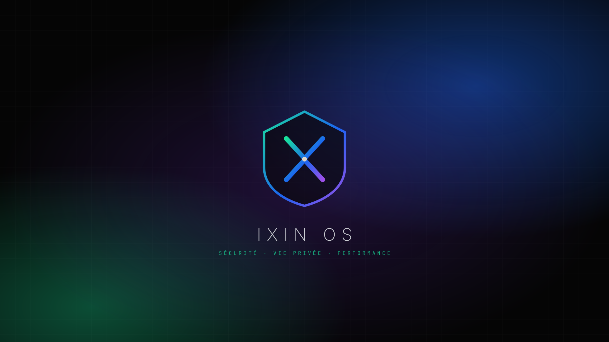

<p align="center"></p>

# IXIN OS

Distribution Linux basée sur **Arch Linux**, à l'image d'[IXIN](https://getixin.com) :
**sécurité, vie privée, performance**. Bureau KDE Plasma 6 organisé comme Windows,
installeur graphique compatible **dual-boot Windows**, et tout le nécessaire pour **jouer
aux jeux Steam / Windows**.



## Contenu

| Domaine | Ce qui est préinstallé |
|---|---|
| **Bureau** | KDE Plasma 6 (Wayland), barre des tâches en bas façon Windows 11 : menu Démarrer au logo IXIN, recherche, applications épinglées, zone de notification, horloge. Thème sombre IXIN (noir `#050505`, émeraude `#19f3a4`, saphir `#1c6bff`), icônes Papirus, polices Inter / JetBrains Mono, écran de démarrage, écran de connexion, GRUB et Plymouth aux couleurs IXIN. |
| **Centre IXIN** | Application maison (`ixin-center`) : accueil, état de sécurité, activation des protections, raccourcis jeux et système. |
| **Jeux** | Steam (+ Proton), Heroic (Epic/GOG/Amazon), Lutris, Bottles, Wine-staging, Winetricks, ProtonUp-Qt (Proton-GE), GameMode, MangoHud, Gamescope, pilotes Vulkan AMD/Intel/NVIDIA 32 et 64 bits, noyau **linux-zen**, zram, BBR. Commande `ixin-gaming %command%` pour Steam. |
| **Sécurité** | Pare-feu UFW (entrant bloqué), AppArmor, sysctl durcis, DNS chiffré (DNS-over-TLS Quad9), MAC Wi-Fi aléatoire, nom d'hôte non envoyé en DHCP, chiffrement de disque LUKS à l'installation, Firejail, OpenSnitch, USBGuard, ClamAV, rkhunter, Lynis, arch-audit. Commande `ixin-secure`. |
| **Vie privée** | Navigateur Tor, Tor + torsocks, Signal, KeePassXC, VeraCrypt, GnuPG/Kleopatra, mat2 / Metadata Cleaner, BleachBit, WireGuard / OpenVPN. |
| **Applications** | Firefox, Thunderbird, LibreOffice, VLC, mpv, OBS Studio, GIMP, Dolphin, Kate, Okular, Gwenview, Spectacle, Discover + Flathub, Timeshift + Snapper (Btrfs). |
| **Mises à jour** | **IXIN Update** : mises à jour automatiques comme sous Windows — correctifs de sécurité installés dès leur publication (détection des CVE via le suivi de sécurité Arch), le reste une fois par jour en arrière-plan, point de restauration Btrfs avant chaque mise à jour, notifications KDE, report pendant les jeux / sur batterie. L'équipe IXIN peut **pousser** des mises à jour et correctifs urgents signés sur tous les PC (dépôt `[ixin]`). Voir [docs/MISES-A-JOUR.md](docs/MISES-A-JOUR.md). |
| **Installation** | **IXIN OS Setup** pour installer depuis Windows sans clé USB ([guide](docs/INSTALLATION-WINDOWS.md)). Calamares : « À côté de Windows » (redimensionnement automatique, partitions Windows jamais effaçables), Btrfs avec sous-volumes `@ @home @cache @log`, chiffrement **LUKS2 (argon2id)** déverrouillé au démarrage sur l'écran IXIN, partition `/boot` séparée de 1 Go (fonctionne avec la petite partition EFI de Windows), GRUB avec une entrée « Windows » qui démarre Windows par le firmware (pas de demande de clé BitLocker). |

## Obtenir l'ISO

### Option 1 — GitHub Actions (recommandé)
1. Onglet **Actions** → **Construire l'ISO IXIN OS** → **Run workflow**.
2. À la fin (~1 à 2 h), une **Release** est créée avec l'ISO découpée en morceaux de 1,9 Go
   (limite GitHub) et la somme SHA-256. Les instructions pour la reconstituer sont dans la Release.

### Option 2 — construire soi-même (sur Arch Linux)
```bash
sudo ./build.sh          # → out/ixin-os-AAAA.MM.JJ-x86_64.iso
```
Depuis une autre distribution, via Docker :
```bash
docker run --rm --privileged -v "$PWD":/src archlinux:latest \
  bash -c 'pacman-key --init && pacman-key --populate && pacman -Syu --noconfirm && cd /src && ./build.sh'
```
Prévoir ~35 Go d'espace disque.

## Installer à côté de Windows (dual-boot)

### Le plus simple : IXIN OS Setup (sans clé USB)

Téléchargez **IXIN-OS-Setup.exe** dans la dernière Release et lancez-le sous Windows 10 ou 11 :
il vérifie le PC (UEFI, espace libre, BitLocker, Secure Boot), télécharge et vérifie IXIN OS,
réduit Windows, prépare le démarrage puis redémarre sur l'installation. Tout est annulable tant
qu'IXIN OS n'est pas installé. Guide complet : [docs/INSTALLATION-WINDOWS.md](docs/INSTALLATION-WINDOWS.md).

### Avec une clé USB

1. **Sous Windows** : désactivez le *Démarrage rapide* (Panneau de configuration → Options d'alimentation)
   et **suspendez BitLocker** si le disque est chiffré — sinon la partition Windows ne peut pas être redimensionnée.
2. Gravez l'ISO sur une clé USB avec **Rufus** (schéma GPT, cible UEFI) ou **Ventoy**.
3. Dans le BIOS/UEFI : désactivez **Secure Boot** (IXIN OS ne fournit pas encore de chargeur signé),
   puis démarrez sur la clé.
4. Sur le bureau live, lancez **Installer IXIN OS** → choisissez **« Installer à côté »**,
   faites glisser le curseur pour répartir l'espace, cochez **Chiffrer le système**.
5. Au redémarrage, GRUB propose IXIN OS **et Windows**.

> Horloge : Windows stocke l'heure en local, Linux en UTC. Si l'heure est décalée sous Windows,
> exécutez dans un terminal administrateur Windows :
> `reg add "HKLM\System\CurrentControlSet\Control\TimeZoneInformation" /v RealTimeIsUniversal /d 1 /t REG_DWORD /f`

## Jeux : ce qui marche, ce qui ne marche pas

* La grande majorité des jeux Steam fonctionnent via **Proton** — vérifiez un jeu sur
  [protondb.com](https://www.protondb.com). Activez Proton pour tous les titres :
  *Steam → Paramètres → Compatibilité*.
* Les jeux Epic / GOG / Amazon passent par **Heroic**, les autres launchers (Battle.net, EA, Ubisoft) par **Lutris** ou **Bottles**.
* ⚠️ **Limite réelle** : les jeux dont l'anti-triche bloque Linux (ex. Valorant, Fortnite,
  certains Call of Duty, Rainbow Six Siege…) **ne fonctionnent pas**, sur aucune distribution Linux.
  Pour ceux-là, gardez Windows en dual-boot. Idem pour quelques logiciels pro (Adobe, certains pilotes propriétaires).

## Sécurité : ce qui est fait, et ce qui ne l'est pas

Aucun système n'est sûr à 100 % — IXIN OS applique des réglages de défense en profondeur
raisonnables sans casser les jeux :

* **Par défaut** : pare-feu entrant fermé, AppArmor, durcissement noyau (kptr/dmesg restreints,
  BPF non privilégié désactivé, ptrace limité, redirections ICMP refusées…), DNS chiffré,
  MAC aléatoire, pas de service réseau exposé (pas de SSH), sudo avec mot de passe.
* **À activer selon vos besoins** (Centre IXIN → Sécurité ou `ixin-secure …`) :
  OpenSnitch (pare-feu applicatif), USBGuard, service Tor.
* **Mises à jour automatiques** (IXIN Update) : les failles corrigées par Arch Linux sont installées dès
  leur publication, et l'équipe IXIN peut pousser ses propres correctifs signés.
* **Bonnes pratiques** : cochez le chiffrement du disque à l'installation, laissez les mises à jour
  en mode automatique, utilisez KeePassXC et des mots de passe uniques.
* Non inclus volontairement : `mitigations=off` et autres réglages qui gagnent quelques % de FPS
  au prix de la sécurité.

## Commandes IXIN

| Commande | Rôle |
|---|---|
| `ixin-center` | Centre IXIN (interface graphique) |
| `ixin-secure [status\|firewall-on\|opensnitch-on\|usbguard-on\|tor-on\|audit\|scan\|rootkit]` | État et réglages de sécurité |
| `ixin-update` | État et mise à jour (IXIN Update) — `status`, `check`, `apply`, `snapshot` |
| `ixin-gaming <cmd>` | Lance un jeu avec GameMode + MangoHud (`--gamescope` en option) |
| `ixin-install` | Lance l'installeur |

## Structure du dépôt

```
build.sh                      script de construction de l'ISO
.github/workflows/            construction de l'ISO + publication du dépôt de mises à jour [ixin]
packages/                     paquets IXIN (ixin-tools, ixin-update, ixin-settings, ixin-artwork…)
repo/policy.json              politique IXIN Update (urgent, blocages, annonces)
tools/                        construction/signature des paquets, clé de signature, migration bêta
windows/                      installation depuis Windows
├── IxinSetup/                IXIN-OS-Setup.exe (C#, .NET Framework 4.8)
└── boot/                     menu GRUB « IXIN OS Setup » (démarre l'ISO depuis le disque)
iso/                          profil archiso
├── profiledef.sh             nom, étiquette, modes de démarrage
├── packages.x86_64           liste des paquets
├── pacman.conf               dépôts (core, extra, multilib, chaotic-aur, local)
├── efiboot/ syslinux/ grub/  menus de démarrage UEFI / BIOS
├── patches/                  correctifs IXIN des paquets AUR (Calamares)
└── airootfs/                 fichiers du système
    ├── etc/calamares/        configuration de l'installeur (+ ixin-modules/ixinguard)
    └── usr/local/bin/        scripts du live (installation)
```

Basé sur Arch Linux et archiso. Arch Linux est une marque de Levente Polyak et Judd Vinet ;
IXIN OS n'est ni affilié ni approuvé par le projet Arch Linux.
