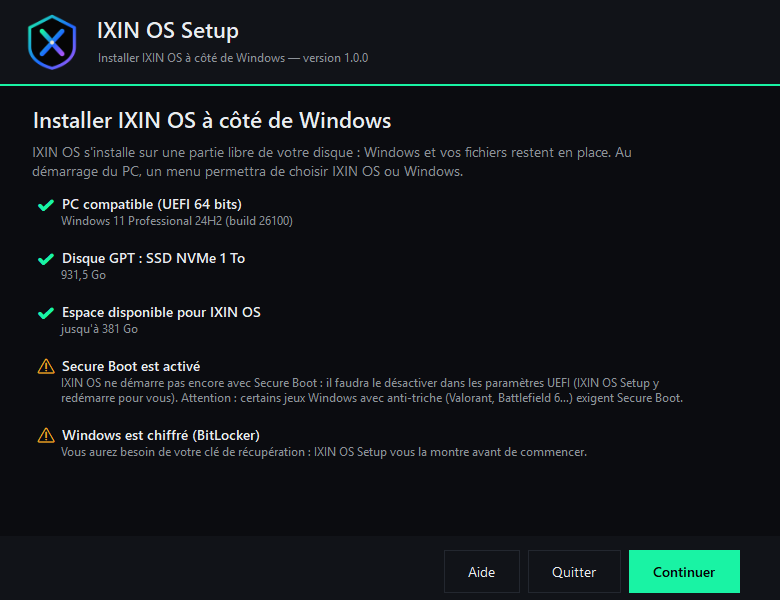
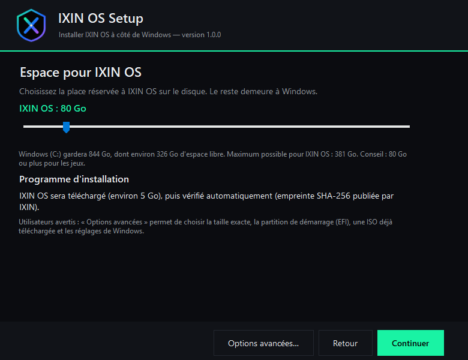
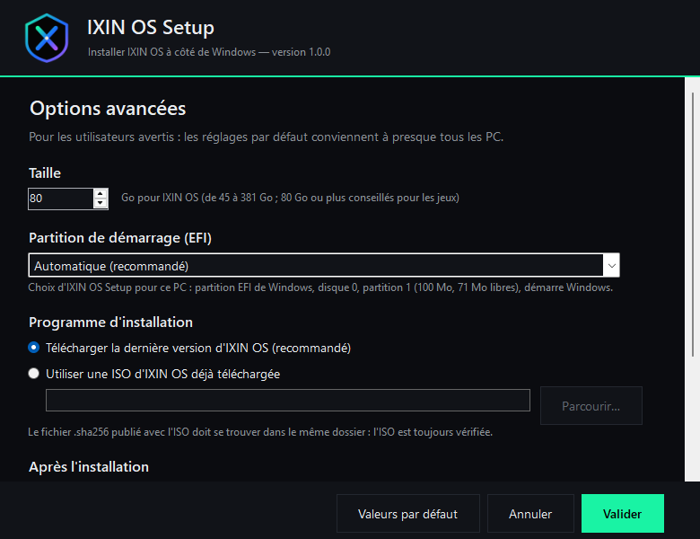
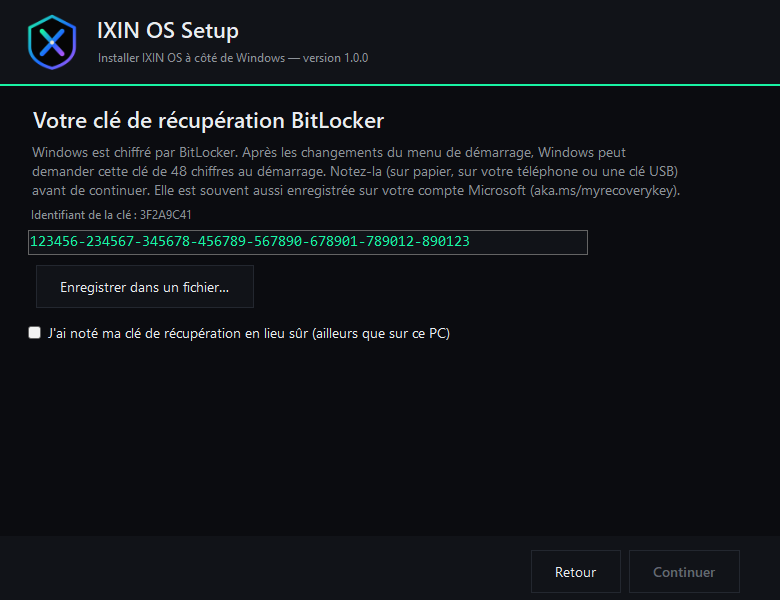
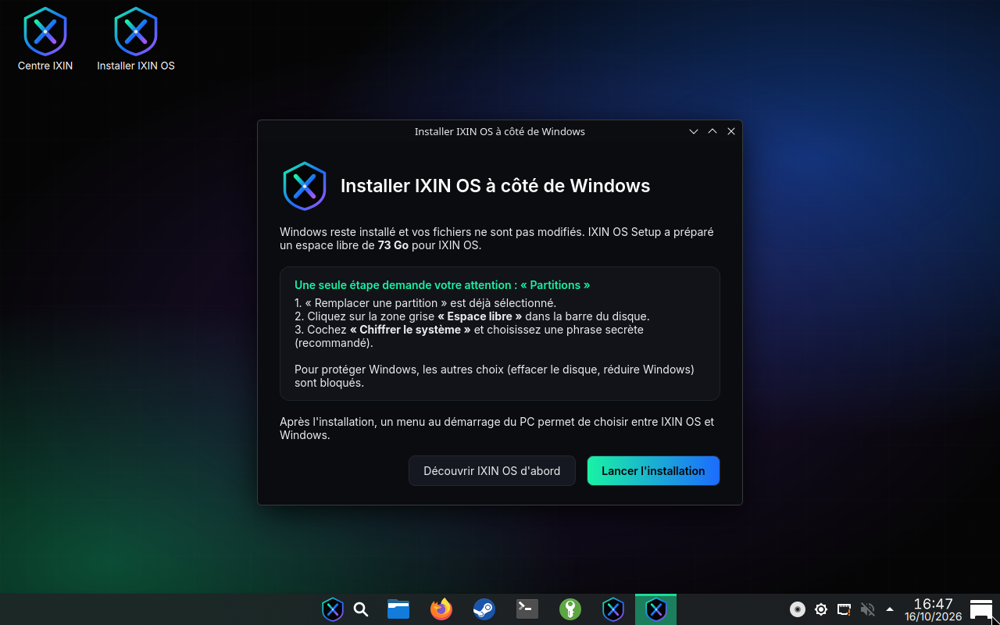
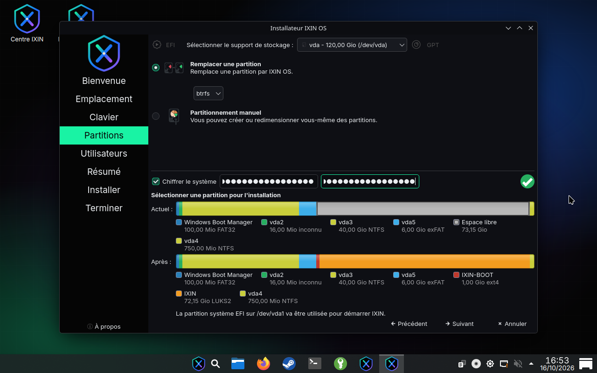
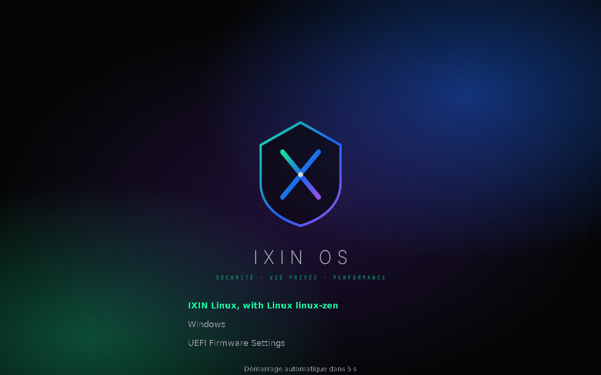
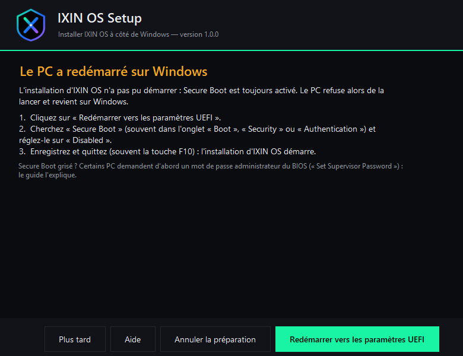
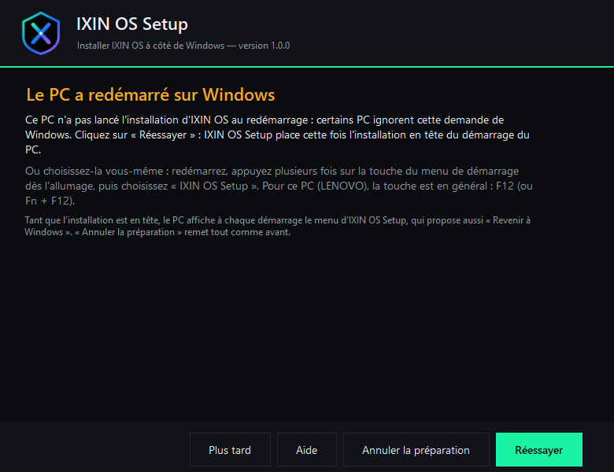

# Installer IXIN OS à côté de Windows — IXIN OS Setup

**IXIN-OS-Setup.exe** installe IXIN OS sur un PC Windows **sans clé USB** : il prépare
l'espace sur le disque depuis Windows, puis redémarre sur l'installation. Windows et vos
fichiers restent en place ; au démarrage du PC, un menu permet ensuite de choisir **IXIN OS**
ou **Windows**.

> Pour installer IXIN OS seul sur un PC, dans une machine virtuelle, ou si votre PC n'est pas
> compatible (voir ci-dessous), utilisez l'ISO sur une clé USB : voir le guide pas à pas
> [« Installer IXIN OS avec une clé USB »](INSTALLATION-CLE-USB.md).

---

## 1. Ce qu'il faut

| | |
|---|---|
| Windows | Windows 10 (version 1607 de 2016 ou plus récente) ou Windows 11, **64 bits**, sur un PC à processeur **Intel ou AMD**. Sur un Windows 32 bits, un PC à processeur ARM (Snapdragon) ou Windows 7 / 8, IXIN OS Setup s'ouvre et explique pourquoi il ne peut pas continuer |
| Démarrage | **UEFI** (cas de presque tous les PC depuis 2012) avec un disque **GPT** ; PC en mode BIOS : clé USB (section 10) |
| Disque de Windows | un disque interne « de base » (presque tous les PC). Windows sur un disque USB, un disque dynamique ou un espace de stockage : clé USB. Disque en mode RAID / Intel RST : accepté, avec un avertissement (voir *Dépannage*) |
| Disques | un ou plusieurs : la partition de démarrage (EFI) de Windows peut se trouver sur un autre disque, IXIN OS Setup la trouve (ou en crée une si besoin) |
| Espace libre sur Windows (C:) | environ **75 Go** : 45 Go minimum pour IXIN OS (80 Go conseillés pour les jeux), 6 Go pour le programme d'installation, 5 Go de téléchargement temporaire, et 20 Go laissés libres à Windows |
| Alimentation | portable branché sur secteur |
| Précaution | une **sauvegarde** de vos fichiers importants (aucun fichier n'est supprimé, mais un disque se modifie toujours avec prudence) |

IXIN OS Setup vérifie tout cela lui-même et explique ce qui bloque.

---

## 2. Installation pas à pas

1. **Téléchargez IXIN-OS-Setup.exe** sur la page des versions (avec l'ISO d'IXIN OS) et lancez-le.
   Windows demande l'autorisation de modifier l'appareil : répondez **Oui**.
   *Si Windows affiche « Windows a protégé votre ordinateur »* : cliquez sur **Informations
   complémentaires → Exécuter quand même** (le programme n'est pas encore signé par un
   certificat de signature de code ; son code source est public, dossier `windows/`).
2. **Vérification du PC** : chaque point est expliqué (✔ bon, ⚠ à savoir, ✖ bloquant).

   

3. **Espace pour IXIN OS** : choisissez la taille (curseur). Le programme d'installation est
   téléchargé automatiquement (environ 5 Go), ou vous pouvez choisir une ISO déjà téléchargée
   (le fichier `.sha256` publié avec elle doit être dans le même dossier).

   

   **Options avancées** (utilisateurs avertis, bouton « Options avancées… ») : taille exacte, partition de
   démarrage (EFI) à utiliser — automatique, une partition EFI existante, ou une partition EFI dédiée à
   IXIN OS (300 Mo, sans toucher à celle de Windows) —, ISO déjà téléchargée, garder la partition
   IXIN-SETUP après l'installation (pour réinstaller sans retélécharger), démarrage rapide de Windows et
   horloge UTC. Les valeurs par défaut conviennent à presque tous les PC.

   

4. **BitLocker** (si Windows est chiffré) : votre **clé de récupération** de 48 chiffres est
   affichée ; notez-la ou enregistrez-la **ailleurs que sur ce PC** (clé USB, téléphone, papier).

   

5. **Confirmation**, puis **préparation** : téléchargement et vérification de l'ISO, réduction
   de Windows, création de la partition « IXIN-SETUP », menu de démarrage. Si Windows propose
   de « formater » un nouveau disque pendant cette étape, cliquez sur **Annuler**.
6. **Redémarrage** :
   - **Secure Boot désactivé** : le PC redémarre directement sur l'installation (une seule fois).
   - **Secure Boot activé** : voir la section 3, puis le PC démarre sur l'installation.
7. Dans le menu **IXIN OS Setup**, choisissez **« Installer IXIN OS (à côté de Windows) »**.
   Le bureau d'IXIN OS s'ouvre avec une fenêtre d'accueil : cliquez sur **« Lancer l'installation »**.

   

8. Dans l'installation, à l'étape **« Partitions »** :
   - le disque et l'espace préparés par IXIN OS Setup sont déjà sélectionnés (« Remplacer une
     partition », zone **« Espace libre »**) — sinon, choisissez le disque de Windows en haut puis
     cliquez sur la zone grise « Espace libre » dans la barre du disque ;
   - cochez **« Chiffrer le système »** et choisissez une phrase secrète (recommandé).

   Pour protéger Windows, effacer le disque ou réduire de nouveau Windows est refusé dans ce mode,
   et une partition Windows ne peut jamais être choisie pour être remplacée.
   *Avec une ISO plus ancienne que build-2026.10.16-4 (choisie dans les options avancées), une option
   « Installer à côté » apparaît aussi : ne la choisissez pas.*

   

9. Terminez l'installation (nom, mot de passe), puis redémarrez. Au démarrage, le menu IXIN propose
   **IXIN OS**, **Windows** et les paramètres du firmware (UEFI). Choisir **Windows** redémarre
   aussitôt le PC directement sur Windows, par son entrée du firmware, exactement comme si IXIN
   n'était pas là : BitLocker ne demande pas sa clé de récupération.

   

Au premier démarrage d'IXIN OS, la partition « IXIN-SETUP » (6 Go) et le menu « IXIN OS Setup »
sont supprimés automatiquement. Pour rendre ces 6 Go à Windows : relancez IXIN OS Setup sous
Windows et cliquez sur **« Rendre … à Windows »** (ou *Gestion des disques → Étendre le volume*).

---

## 3. Secure Boot

IXIN OS ne démarre pas encore avec Secure Boot activé (prévu dans une prochaine version).
IXIN OS Setup redémarre directement dans les **paramètres UEFI** du PC :

1. cherchez **Secure Boot** (souvent dans l'onglet *Boot*, *Security* ou *Authentication*) ;
2. réglez-le sur **Disabled** ;
3. enregistrez et quittez (souvent **F10**).

Si le PC redémarre sur Windows au lieu de l'installation (Secure Boot encore activé, par exemple),
**IXIN OS Setup se rouvre tout seul** à l'ouverture de session et explique quoi faire : il propose de
retourner dans les paramètres UEFI, ou de réessayer.

Option grisée ? Certains PC demandent d'abord un **mot de passe administrateur du BIOS**
(« Set Supervisor Password ») ; désactivez ensuite Secure Boot, puis retirez ce mot de passe si vous le
souhaitez. Sur d'autres, il faut choisir « **Other OS** » au lieu de « Windows UEFI mode ».

⚠️ **Jeux Windows** : certains jeux avec anti-triche (Valorant, Battlefield 6…) exigent Secure Boot
**sous Windows**. Tant que Secure Boot est désactivé, ces jeux ne se lancent plus sous Windows.

---

## 4. BitLocker et chiffrement de l'appareil

Si Windows est chiffré, IXIN OS Setup :
- affiche votre clé de récupération et ne continue qu'une fois qu'elle est notée (il en crée une
  si le disque n'en a pas) ;
- suspend la protection BitLocker pendant **3 démarrages** de Windows : les changements du
  démarrage (menu IXIN, désactivation de Secure Boot) ne déclenchent alors pas la demande de clé ;
  Windows réactive ensuite la protection tout seul.

Si Windows demande malgré tout la clé de récupération au démarrage, saisissez-la : elle est aussi
souvent enregistrée sur votre compte Microsoft (**aka.ms/myrecoverykey**).

---

## 5. Annuler

Tant qu'IXIN OS n'est pas installé, relancez IXIN OS Setup et choisissez
**« Annuler la préparation »** : la partition IXIN-SETUP, le menu de démarrage et les réglages
sont retirés, et l'espace est rendu à Windows. En cas d'erreur ou d'annulation pendant la
préparation, cette remise en état est automatique.

---

## 6. Dépannage

**« Partition de démarrage (EFI) sur un autre disque »** (information, pas une erreur) — sur les PC
installés avec deux disques branchés, Windows démarre souvent depuis la partition EFI de l'autre disque.
IXIN OS l'utilise aussi : ne retirez pas ce disque du PC (Windows ne démarrerait plus non plus).

**« Une partition de démarrage (EFI) sera créée pour IXIN OS »** (information) — aucune partition EFI
utilisable n'a été trouvée (absente, presque pleine, ou sur un disque USB) : IXIN OS Setup crée
automatiquement une partition EFI de 300 Mo « IXIN-EFI », prise sur l'espace d'IXIN OS.

**« C: ne peut pas être réduit assez »** — Windows a assez d'espace libre, mais des fichiers système
impossibles à déplacer se trouvent en fin de disque (Windows ne peut pas réduire sa partition au-delà) :

1. cliquez sur **« Débloquer la réduction »** : la mise en veille prolongée est désactivée (le fichier
   `hiberfil.sys` disparaît) et l'espace libre est regroupé, puis l'analyse est refaite ;
2. si ce n'est pas suffisant, désactivez temporairement le **fichier d'échange** : menu Démarrer →
   « Afficher les paramètres système avancés » → *Performances : Paramètres* → *Avancé* →
   *Mémoire virtuelle : Modifier* → décochez « Gestion automatique », choisissez **« Aucun fichier
   d'échange »** → *Définir* → *OK*, **redémarrez** et relancez IXIN OS Setup. Une fois la préparation
   terminée, remettez « Gestion automatique » ;
3. si c'est encore insuffisant, les **points de restauration** de Windows peuvent bloquer aussi :
   menu Démarrer → « Créer un point de restauration » → *Configurer* → *Supprimer* (les anciens points
   de restauration sont perdus), puis relancez IXIN OS Setup.

**Le menu « IXIN OS Setup » n'apparaît pas au redémarrage** — certains PC ignorent la demande de
démarrage unique de Windows. IXIN OS Setup se rouvre alors tout seul à l'ouverture de session : cliquez
sur **« Réessayer »** — l'installation est cette fois placée **en tête** de l'ordre de démarrage du PC
(le menu d'IXIN OS Setup s'affichera à chaque démarrage, avec « Revenir à Windows », jusqu'à l'installation
ou à « Annuler la préparation »). Le programme indique aussi la touche du menu de démarrage de votre
marque de PC (**F12** sur Dell, Lenovo et Acer, **Échap puis F9** sur HP, **F8** ou **Échap** sur Asus,
**F11** sur MSI) : choisissez-y **« IXIN OS Setup »**.

**« Windows a protégé votre ordinateur » / « Smart App Control a bloqué… »** — IXIN OS Setup n'est pas
encore signé par un certificat. SmartScreen : *Informations complémentaires* → *Exécuter quand même*.
Smart App Control (Windows 11, nouvelles installations) bloque tout programme non signé, sans bouton pour
passer outre : *Sécurité Windows* → *Contrôle des applications et du navigateur* → *Paramètres de Smart App
Control* → **Désactivé** — ou installez IXIN OS avec une clé USB.

**« Disque en mode RAID / Intel RST »** (avertissement) — fréquent sur les portables récents (Intel VMD).
IXIN OS reconnaît ces disques dans la plupart des cas. Si l'installation d'IXIN OS n'affiche **aucun
disque** à l'étape « Partitions », revenez à Windows (« Revenir à Windows » dans le menu de démarrage, ou
redémarrez) : rien n'a été modifié par l'installation. Passer le contrôleur en mode **AHCI** dans les
paramètres du PC règle le problème, mais Windows doit y être préparé d'abord (démarrage en mode sans
échec), sans quoi il ne démarre plus : demandez de l'aide si vous n'êtes pas à l'aise.

**« Ce PC a un processeur ARM », « Windows 32 bits », « Version de Windows trop ancienne »** — IXIN OS
Setup ne peut pas préparer l'installation sur ce PC ; rien n'a été modifié. Windows 32 bits ou ancien sur
un PC 64 bits : IXIN OS s'installe avec une clé USB. Processeur ARM : IXIN OS ne peut pas s'y installer.

**Le téléchargement s'interrompt** — IXIN OS Setup reprend tout seul après une coupure (Wi-Fi instable,
mise en veille) ; s'il finit par s'arrêter, relancez-le : il repart de là où il en était.

**Après l'installation, le PC démarre directement sur Windows, sans le menu IXIN** — certaines mises
à jour de Windows remettent Windows en premier dans l'ordre de démarrage. Relancez IXIN OS Setup et
cliquez sur **« Remettre le menu IXIN au démarrage »** (ou choisissez « IXIN » dans le menu de démarrage
du PC, touches ci-dessus).

**Windows demande la clé de récupération BitLocker** — voir la section 4.

---

## 7. Ce qui est modifié sur le PC

| Modification | Retour en arrière |
|---|---|
| Windows (C:) réduit de la taille choisie + 6 Go | « Annuler la préparation » le rend à Windows |
| Partition exFAT « IXIN-SETUP » (6 Go, sans lettre de lecteur) contenant l'ISO vérifiée | supprimée au premier démarrage d'IXIN OS, ou par « Annuler » |
| `\EFI\IXIN-SETUP\` (chargeur de 3 Mo + `options.cfg`) dans la partition EFI de Windows, ou dans celle choisie | idem |
| Partition EFI « IXIN-EFI » de 300 Mo, seulement si nécessaire ou demandée (options avancées) | supprimée par « Annuler » ; gardée une fois IXIN OS installé (il démarre avec) |
| Entrée « IXIN OS Setup » du menu de démarrage du PC (Windows reste le choix par défaut) | idem |
| Démarrage rapide de Windows désactivé, horloge matérielle en UTC (modifiables dans les options avancées) | « Annuler » rétablit les anciennes valeurs |
| BitLocker suspendu 3 démarrages (si actif) | réactivation automatique par Windows |
| Tâche planifiée « IXIN OS Setup » (une seule fois, à la prochaine ouverture de session après « Redémarrer et installer ») et copie du programme dans `C:\ProgramData\IXIN` : rouvre IXIN OS Setup si le PC revient sur Windows | retirée dès que le programme s'est rouvert, ou par « Annuler » |
| Services Windows « Disque virtuel », « Stockage » ou WMI, seulement s'ils avaient été **désactivés** (logiciels d'« optimisation ») : remis en démarrage manuel, leur réglage d'origine | — |

Journal détaillé : `C:\ProgramData\IXIN\setup.log` ; état : `C:\ProgramData\IXIN\setup-state.json`.

---

## 8. Sécurité

- L'ISO est toujours vérifiée avec l'**empreinte SHA-256** publiée avec la version, après le
  téléchargement puis après sa copie dans la partition IXIN-SETUP.
- Le programme utilise les commandes de stockage de Windows lui-même (celles de *Gestion des
  disques*) et ne touche jamais aux fichiers de Windows.
- Le code source est public : `windows/IxinSetup/` (programme) et `windows/boot/` (menu de
  démarrage). Il est testé à chaque modification sur un vrai Windows, sur un disque virtuel
  (préparation complète puis annulation).

## 9. Limites connues

- Démarrage BIOS (Legacy) ou disque MBR : non pris en charge par IXIN OS Setup, utilisez une clé USB
  (section 10).
- PC avec plusieurs disques : IXIN OS s'installe sur le disque de Windows (la partition EFI, elle, peut
  être sur un autre disque).
- Secure Boot : à désactiver (section 3).
- Testé sur Windows (disque virtuel) et, côté IXIN OS, de bout en bout en machine virtuelle sur un PC
  Windows simulé (menu IXIN OS Setup, installation dans l'espace libre, nettoyage, menu IXIN / Windows) ;
  à valider sur une grande variété de PC réels (firmwares de marques différentes) : signalez tout
  problème avec le fichier `C:\ProgramData\IXIN\setup.log`.

---

## 10. Installer avec une clé USB (PC en mode BIOS, disque MBR, PC sans Windows)

Le guide complet, pas à pas et pour débutants, est ici :
**[Installer IXIN OS avec une clé USB](INSTALLATION-CLE-USB.md)**. En résumé :

1. Il faut une **clé USB de 8 Go** ou plus : **tout son contenu sera effacé**.
2. Téléchargez l'ISO en **un seul fichier** sur [os.ixin.online/telecharger](https://os.ixin.online/telecharger)
   (sur la page des versions GitHub, elle est découpée en morceaux à recoller : voir le guide).
3. Téléchargez **Rufus** (rufus.ie), branchez la clé, choisissez-la dans *Périphérique*, cliquez sur
   *Sélection* pour choisir `ixin-os.iso`, puis *Démarrer*. Si Rufus demande un mode d'écriture,
   choisissez **« Écrire en mode Image DD »**.
4. Redémarrez le PC en appuyant sur la touche du **menu de démarrage** (F12 sur Dell et Lenovo, F9 sur HP,
   F8 sur Asus, F11 sur MSI, Échap ou F12 sur Acer) et choisissez la clé USB.
5. IXIN OS démarre depuis la clé : double-cliquez sur **« Installer IXIN OS »**. À l'étape
   « Partitions », **« Installer à côté »** réduit Windows pour faire de la place (glissez le séparateur
   pour choisir la taille), **« Effacer le disque »** remplace tout le contenu du disque choisi.

Sur un PC en mode BIOS, l'installation à côté de Windows depuis une clé USB est encore peu testée :
sauvegardez vos fichiers importants avant de commencer.
